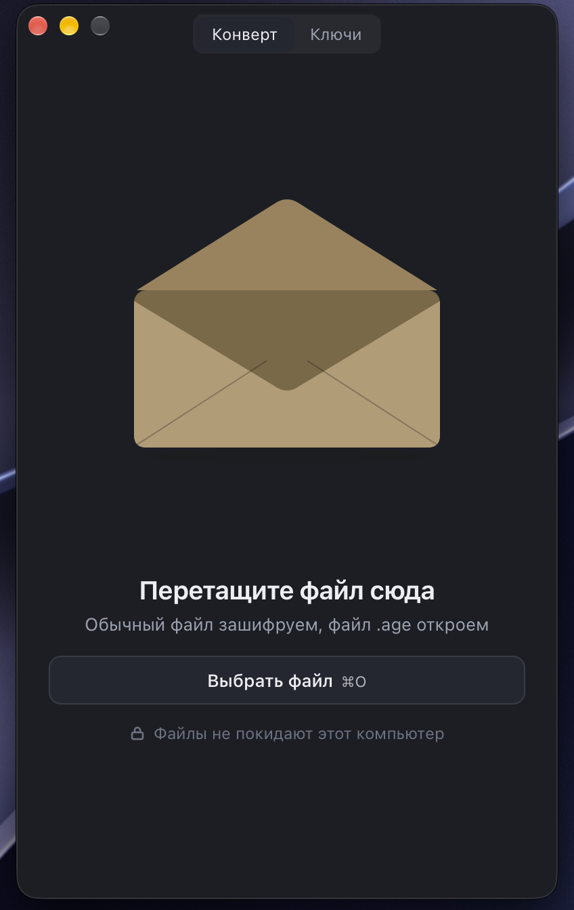

<p align="center">
  
</p>

<h1 align="center">Конверт</h1>

<p align="center">
  Шифрует файлы перетаскиванием: бросил файл в окно, получил запечатанный конверт.<br>
  Открытый формат <a href="https://age-encryption.org">age</a>, всё считается на этом компьютере. macOS и Windows.
</p>

<p align="center">
  <a href="https://github.com/vldvr/konvert/releases/latest"><b>Скачать последнюю версию</b></a>
</p>

<p align="center">
  
</p>

## Что умеет

**Шифрование паролем.** Пароль превращается в ключ через scrypt. Есть индикатор надёжности и генератор пароля из слов.

**Шифрование для получателей.** Файл запечатывается публичными ключами `age1…` одного или нескольких получателей; открыть его сможет только тот, у кого есть парный личный ключ. Свой ключ создаётся при первом запуске, его публичную часть можно скопировать и отправить. Список получателей хранится с именами.

**Расшифровка.** Файл `.age` открывается перетаскиванием, двойным щелчком или через «Открыть в программе». Конверт сам понимает, нужен ли пароль, запечатан ли файл для вашего ключа или для чужого.

**Аккуратно с файлами.**

- Ничего не перезаписывает: если имя занято, добавляет « (2)», « (3)»…
- Пишет через временный файл: после ошибки не остаётся недописанных файлов.
- Подделку замечает: age проверяет целостность каждого блока.
- По желанию убирает оригинал в Корзину после шифрования.

Сетевых запросов нет. Формат стандартный, поэтому конверты открываются и без Конверта, обычной утилитой [`age`](https://github.com/FiloSottile/age) или [`rage`](https://github.com/str4d/rage).

Папки пока не поддерживаются: их нужно сначала сжать в архив.

## Установка

На странице [релизов](https://github.com/vldvr/konvert/releases/latest) лежат `.dmg` для macOS (`aarch64` — Apple silicon, `x64` — Intel) и `.exe`/`.msi` для Windows.

Приложение не подписано сертификатом разработчика, поэтому при первом запуске система предупредит.

**macOS**

1. Перетащи Конверт в «Программы» и открой. macOS скажет, что не может проверить разработчика. Нажми «Готово».
2. Открой «Системные настройки → Конфиденциальность и безопасность».
3. Внизу будет строка «Программа „Konvert“ заблокирована». Нажми «Всё равно открыть» и подтверди паролем или Touch ID.

Это нужно один раз. Убрать предупреждение совсем можно только сертификатом Developer ID и нотаризацией Apple.

**Windows.** В окне SmartScreen нажми «Подробнее» → «Выполнить в любом случае».

## Где хранятся ключи

- **Личный ключ** — в Связке ключей (macOS) или в диспетчере учётных данных Windows, запись `app.konvert.desktop` / `age-identity`.
- **Список получателей** — `contacts.json` в папке настроек (на macOS `~/Library/Application Support/app.konvert.desktop/`). Там только имена и публичные ключи.

> **Важно.** Экспорта личного ключа пока нет. Если запись в Связке ключей пропадёт, файлы, запечатанные для твоего ключа, открыть не получится. Конверты с паролем от ключа не зависят.

## Разработка

Нужны [Rust](https://rustup.rs), Node.js 18+ и [системные зависимости Tauri](https://tauri.app/start/prerequisites/).

```bash
npm install
npm run dev                  # запуск с перезагрузкой
npm run build                # установщики в src-tauri/target/release/bundle
cd src-tauri && cargo test   # тесты ядра
```

| Путь | Что там |
|---|---|
| `ui/` | интерфейс: HTML, CSS и JS без сборщика |
| `src-tauri/src/lib.rs` | ядро: шифрование, ключи, работа с файлами. Вся криптография — крейт `age` |
| `src-tauri/tauri.conf.json`, `capabilities/` | настройки окна, ассоциация `.age`, разрешения |
| `scripts/build.mjs` | релизная сборка без локальных путей в бинарнике |
| `.github/workflows/release.yml` | сборка установщиков в GitHub Actions |
| `docs/` | скриншоты для README |

**Выпуск версии.** Подними версию в `package.json`, `src-tauri/Cargo.toml` и `src-tauri/tauri.conf.json`, затем отправь тег:

```bash
git tag v0.1.0 && git push origin v0.1.0
```

Actions соберёт установщики для macOS (arm64, x64) и Windows в черновик релиза. Проверь его и опубликуй.

## Лицензия

[MIT](LICENSE)
